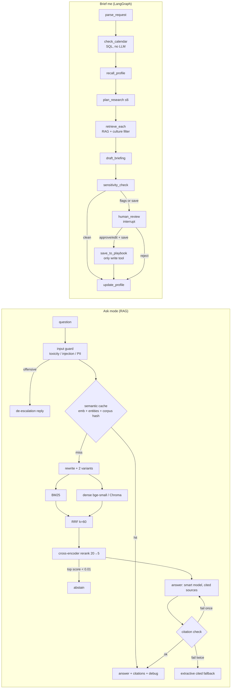

# BridgeBot v2 architecture: concept → file → why

## Concepts

| Concept | File | Why it's built this way |
|---|---|---|
| Shared retrieval core | `bridgebot/ragcore/` | One small package written once and copied into Rexetive (`backend/ragcore/`). Relative imports make the copy work unchanged, and neither repo depends on the other. |
| Heading-aware chunking | `ragcore/chunker.py` | Chunks follow document structure. The heading path is prefixed so a chunk is self-describing. Tokens are estimated as words × 1.33 (no tokenizer dependency). |
| Lexical retrieval (BM25) | `ragcore/sparse.py` | Exact names, festivals and hyphenated terms. The tokenizer keeps `al-adha` and also emits `al` and `adha`. |
| Dense retrieval | `ragcore/dense.py` | bge-small-en-v1.5 (384-d, CPU-friendly) with normalised vectors and a query-side instruction prefix. Persistent Chroma with metadata filters. |
| Rank fusion | `ragcore/fusion.py` | RRF combines rank lists from retrievers whose scores live on different scales. k=60 is the standard constant. |
| Reranking + abstention | `ragcore/rerank.py`, `pipeline.py` | The cross-encoder reads query and passage together, which is more accurate but slower, so it only sees the top 20. Its score gates abstention. |
| Query rewriting | `ragcore/rewrite.py` | Resolves follow-ups and adds paraphrases. Retrieval uses the rewrite; the reranker scores against it. |
| Pipeline with switches | `ragcore/pipeline.py` | Every stage can be toggled, so evals and the UI can show what each stage contributes. `debug` records every stage. |
| Model routing + offline mode | `ragcore/llm.py` | The fast model handles rewrite, plan, judge, classify and SQL; the smart model handles answers and drafts. OpenAI by default, Anthropic via `LLM_PROVIDER`. Structured outputs (Pydantic) with one retry. With no key, deterministic fallbacks run instead. |
| Guards | `ragcore/guards.py` | Code, not prompt lines: injection patterns, PII masking (Luhn-checked cards, IBAN), toxicity rules plus an optional moderation API, citation check. |
| Semantic cache | `ragcore/cache.py` | The entity key stops "Japan" and "China" questions sharing answers (their raw similarity is 0.87). The corpus hash invalidates the cache automatically when sources change. |
| Safe SQL (shared) | `ragcore/sql_guard.py` | Used by Rexetive analytics: a sqlglot parse with allowlists, plus a read-only connection and a time budget. |
| Tracing | `ragcore/trace.py` | One JSONL line per step (latency, tokens, cache hit, decision). A ContextVar lets LLM calls attribute tokens to the current step. |
| Retrieval metrics | `ragcore/evals.py` | Answer-level Recall@k, MRR and nDCG@5. Overlapping chunks holding the same answer count as one answer. |
| Corpus + entity vocabulary | `bridgebot/corpus.py` | Loads front-matter markdown, builds the index once per process, and maps entities to canonical names (demonyms → country). |
| Ask service | `bridgebot/ask.py` | The guarded flow above. Follow-ups without their own entities bypass the cache because their meaning depends on history. |
| Short- vs long-term memory | `bridgebot/store.py` | `chat_history` per session (short-term); `profiles` and `playbook` persist across sessions (long-term). |
| Agent state + schemas | `bridgebot/agent/schemas.py` | `BriefState` TypedDict with an additive `events` log; Pydantic models for every LLM output and tool input. |
| Agent tools | `bridgebot/agent/tools.py` | Three typed tools, each imported only by the node that needs it. The playbook write is reachable only after human approval. |
| Agent nodes | `bridgebot/agent/nodes.py` | One job per node. Calendar relevance is data-driven (an observance is relevant if the country has a matching public holiday) and never infers religion from nationality. |
| Graph + checkpointer | `bridgebot/agent/graph.py` | `interrupt()` pauses and the SQLite checkpointer persists the paused state, so `Command(resume=…)` works even after a restart. Recursion limit 20. |
| Checkpointer vs profile store | `agent/graph.py` vs `store.py` | The checkpointer is the execution state of *one run* (thread_id), enabling pause and resume. The profile is knowledge *about the user*, used across runs. |
| API | `bridgebot/api.py` | Thin FastAPI adapter with Pydantic bodies (422 on bad input) and 409 when resuming a briefing that isn't paused. |
| UI | `bridgebot/ui.py`, `app.py` | Gradio Blocks with three tabs. It calls the same functions as the API. The tracing context is entered around each graph step so Gradio can resume the generator on any thread. |
| Evals | `bridgebot/evals/` | `run_all` writes `data/logs/eval_report.md`. `generate_evals` turns thumbs-up and synthetic questions into `needs_review` cases. |

## Request lifecycle (Ask)

1. `mask_pii` → `check_toxicity` → `detect_injection` (`ask.py::_ask`)
2. `canonical_entities` → `SemanticCache.lookup` (skipped for entity-less follow-ups)
3. `RagPipeline.retrieve`: rewrite → BM25 + dense per query → RRF → rerank → abstain decision
4. `generate_answer`: smart model → `citation_check` → regenerate once → extractive fallback
5. `store.add_turn` (masked text) → cache store → `AskResult` with `debug`, latencies, tokens

## Trade-offs worth knowing

- **Offline answers are extractive.** They are grounded and cited by construction, but less fluent. Their groundedness score of 1.0 is by construction, not a quality claim.
- **Toxicity rules are pattern-based.** They are fast, deterministic and testable (10/10 red-team prompts, 0/46 false positives) but miss paraphrased hate. The moderation API adds a second layer when a key is present.
- **The abstain threshold (0.01) was tuned on 46 questions.** A larger unanswerable set would make it more trustworthy.
- **SQLite everywhere.** It's right for a single-process demo. Multiple instances would need Postgres plus a vector DB service.
