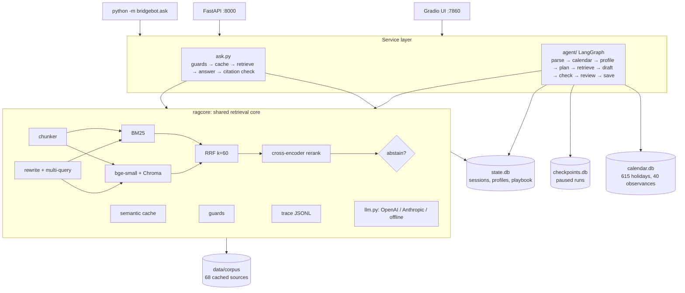

# BridgeBot v2: cultural intelligence for global teams

> Cited, respectful guidance for people working across cultures (business trips, hosting
> international guests, relocation), plus a one-page briefing before a cross-cultural meeting
> that a human reviews before it is shared.

🥉 v1 won **3rd place at the UOWD Tech Club AI Hackathon** (November 2024). v2 rebuilds it as
a production-style RAG system and agent. The v1 code is on the `master` branch, and
[V1_TO_V2.md](V1_TO_V2.md) lists every fix with its file and test.

## What it does

- **Ask:** a chat that answers from 68 curated public sources. Every claim cites a numbered source. The bot says "my sources don't cover this" when retrieval confidence is low, and de-escalates offensive input respectfully (v1's tone rules: correct misinformation, give context, de-escalate).
- **Brief me:** "Business lunch with Saudi partners in Riyadh on 5 March" → a LangGraph agent checks a holiday/observance calendar (it flags Ramadan), recalls your profile (diet, past trips), plans research, retrieves per culture, and drafts a cited briefing (Greetings / Food & drink / Gifts / Topics to avoid / Timing & calendar). A sensitivity check runs next. If anything is flagged, or you want it in the team playbook, the graph **pauses for human review** (`interrupt()`). Only an approve or edit writes to the playbook.
- **Evals:** a retrieval/answer/safety/cache/agent report you can regenerate from the UI or the CLI.

## Architecture



Details, one row per concept: [ARCHITECTURE.md](ARCHITECTURE.md). Demo walkthrough: [DEMO_SCRIPT.md](DEMO_SCRIPT.md).

## v1 → v2: what changed and why

| v1 | v2 | Why |
|---|---|---|
| One web page as the knowledge base. It is a JavaScript app, so v1 actually indexed one sentence: "You need to enable JavaScript". | 67 Wikipedia articles + the v1 page (rendered), cached as markdown with metadata | Real grounding, citations, offline demo |
| 200-*character* chunks | Heading-aware ~400-token chunks with overlap and heading path | Whole ideas per chunk, with section context |
| Vector search only | BM25 + dense, fused with RRF | Exact names and paraphrases both work |
| No reranking | Cross-encoder top 20 → 5, plus an abstain threshold | Precision at rank 1; honest "I don't know" |
| Follow-ups searched literally | Standalone rewrite + 2 query variants | "What about gifts there?" finds Japan |
| No citations | Numbered sources, `[n]` per claim, citation check with regenerate + safe fallback | Verifiable answers |
| Guardrails as a prompt line | Separate input/output guards in code | Testable and can't be talked out of |
| Global chat history shared by all users | Per-session history + long-term profile memory | Privacy and correctness |
| Re-scrape and re-embed every start | Persistent index keyed by corpus hash (reload 0.2 s) | Fast start-up, works offline |
| No evals | Golden set, retrieval/answer/safety/cache/agent evals, eval generator | Know whether a change helps |
| No cache | Semantic cache (embedding + entities + corpus hash) | ~10x faster repeats, no wrong-country hits |
| Q&A only | Brief-me agent with human review before any write | The actual job-to-be-done |

## Eval results (measured)

From `python -m bridgebot.evals.run_all` on 2026-11-01, **offline mode** (no API key), so
rewrite is the offline entity-append version and the groundedness judge is token overlap.
The full report is in [`data/logs/eval_report.md`](data/logs/eval_report.md). Golden set: 46
questions (12 exact-name, 18 paraphrase, 8 follow-up, 8 unanswerable), each mapped to the
chunks containing its answer sentence. Recall@k is answer-level: did any chunk holding the
answer appear in the top k?

| config | R@1 | R@3 | R@5 | MRR | nDCG@5 |
|---|---|---|---|---|---|
| dense only | 0.342 | 0.632 | 0.684 | 0.482 | 0.534 |
| BM25 only | 0.316 | 0.526 | 0.658 | 0.432 | 0.488 |
| hybrid (RRF) | 0.395 | 0.763 | 0.789 | 0.549 | 0.610 |
| hybrid + rerank | 0.553 | 0.711 | 0.789 | 0.643 | 0.679 |
| + rewrite (offline) | **0.632** | **0.842** | **0.868** | **0.730** | **0.765** |

What the numbers say, including what did **not** help:
- **Hybrid > either retriever alone:** R@3 goes from 0.632 (dense) and 0.526 (BM25) to 0.763.
- **Reranking improves the top result** (R@1 0.395 → 0.553, MRR 0.549 → 0.643), but it **hurt exact-name questions at R@3/R@5** (0.917 → 0.833 and 1.000 → 0.833). For those, hybrid without rerank was best. I kept the reranker because it also supplies the abstain signal.
- **Rewrite only matters for follow-ups**, but there it is decisive: follow-up R@5 goes from 0.625 to 1.000 (n = 8). Exact-name and paraphrase scores are unchanged.
- **Abstention:** threshold sweep on the top rerank score; 0.01 classified all 46 questions correctly. 0.05 and above starts refusing answerable questions. Only 8 unanswerables, so treat this as indicative.

| Other checks | Result |
|---|---|
| Offensive prompts de-escalated | 10/10 |
| False positives on benign questions | 0/46 |
| Answer groundedness / citation coverage (offline extractive answers) | 1.000 / 1.000, **by construction** (extractive answers copy cited sentences); the LLM judge runs when a key is set |
| Abstain accuracy, full pipeline | 1.000 (46/46) |
| Semantic cache | paraphrase hit at similarity 0.978; Japan vs China never shares an answer (raw similarity 0.868, separated by the entity key); hit ~0.06-0.1 s vs miss ~0.9-1.3 s across runs |
| Brief-me trajectories | 9/9 pass (Ramadan flagged, Holi not flagged for Saudi Arabia, interrupt on save, reject saves nothing, approve saves once, edit saves edited text, resume after restart, plan ≤ 6) |
| Unit tests | `pytest -q`: 52 passed |

## Run it

Requirements: Windows 11, Python 3.10 or 3.11 (built and tested on 3.10.11), about 2 GB disk.

```powershell
cd BridgeBot
run_demo.bat                      # creates the venv if needed, builds what's missing, starts API + UI
```

Or step by step:

```powershell
py -3.10 -m venv .venv
.venv\Scripts\pip install torch --index-url https://download.pytorch.org/whl/cpu
.venv\Scripts\pip install -r requirements.txt
copy .env.example .env            # then paste OPENAI_API_KEY (optional; works offline without it)
.venv\Scripts\python scripts\download_models.py      # once, ~220 MB
.venv\Scripts\python -m bridgebot.ask "How should I greet my host in Japan?"
.venv\Scripts\python -m uvicorn bridgebot.api:app --port 8000   # http://localhost:8000/docs
.venv\Scripts\python app.py                                     # http://localhost:7860
.venv\Scripts\python -m bridgebot.evals.run_all                 # writes data/logs/eval_report.md
.venv\Scripts\python -m pytest -q
```

**Provider switch:** `LLM_PROVIDER=openai` (default: `gpt-4o-mini` fast, `gpt-4o` smart) or
`LLM_PROVIDER=anthropic` (`claude-haiku-5-5` fast, `claude-opus-5-5` smart), or `LLM_PROVIDER=gemini` with `GEMINI_API_KEY` (default `gemini-3.8-flash` for both tiers, via Google's OpenAI-compatible endpoint). **Offline:** no key,
or `OFFLINE=1`. Every LLM step then uses a deterministic fallback, and the UI badge says
"Offline".

Rebuild data (optional; the cached files are committed): `scripts\build_corpus.py --force`,
`scripts\build_calendar.py`.

## Shared code

`bridgebot/ragcore/` is a small internal retrieval package. The same files are copied into
Rexetive (`backend/ragcore/`). It's shared code, not a dependency: no cross-repo import.

## Known issues

- Python 3.11 was requested but isn't installed on the build machine; everything was built and tested on 3.10.11. All dependencies support 3.11.
- All measured results above are offline. With an API key, the LLM rewrite, answer generation and LLM judge run instead, but no keyed eval run has been recorded yet.
- Offline briefings are extractive: grounded and cited, but some bullets are only loosely on-topic.
- Wikipedia's API rate-limits bulk fetches; `build_corpus.py` backs off and retries, and a full rebuild takes a few minutes.

## Attribution and licence

Corpus text is from English Wikipedia, licensed [CC BY-SA 4.0](https://creativecommons.org/licenses/by-sa/4.0/).
Each file in `data/corpus/` keeps its source URL and retrieval date, and every answer links to its
sources. `religiondatabase-browse.md` is listing metadata from the Database of Religious
History (religiondatabase.org), kept as v1's original source. Public holidays come from the
[`holidays`](https://pypi.org/project/holidays/) package (MIT). Observance dates were read
from the linked Wikipedia articles. Code: MIT licence (see `LICENSE`).
